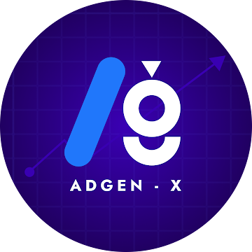

# LetsGoAdGenX (ADGEN-X) — Premium Digital Solutions & Creative Agency

A production-ready website for **LetsGoAdGenX**, engineered with React, Vite, TypeScript, Tailwind CSS, Framer Motion, and Lucide icons.



## Brand Identity
- **Company Name:** LetsGoAdGenX
- **Brand Identity:** ADGEN-X
- **Tagline:** BUILD. BRAND. GROW.
- **Supporting Tagline:** Your Vision. Our Creativity. Your Growth.
- **Official Email:** [letsgoadgenx@gmail.com](mailto:letsgoadgenx@gmail.com)
- **Primary WhatsApp:** [+91 90801 04624](https://wa.me/919080104624)
- **Contact Numbers:**
  - `+91 90801 04624` (Primary)
  - `+91 79045 05060`
  - `+91 63742 58264`

---

## Key Features
- **Official Brand Design System**: Deep dark luxury theme (`#080914`, `#0E1020`, `#14172A`), electric blue (`#38BDF8`), brand violet (`#8B5CF6`), and bright lavender (`#B7A0FF`).
- **Interactive Abstract Hero Visual**: 3D orbital hub featuring the official ADGEN-X logo, floating glass cards for full-stack code, brand swatches, and live performance metrics (+340%).
- **Core Services + Photography & UI/UX**: Software Development, Mobile Apps, Websites, Web Applications, Digital Marketing, Graphic Design, Video Editing, UI/UX Design, and **Photography & Visual Production**.
- **Dedicated Photography Production Suite**: Complete `/services/photography` portal featuring 10 specialized photography disciplines, dedicated 8-category photography portfolio, accessible image lightbox with keyboard navigation, 5-step shoot workflow (Discuss, Plan, Shoot, Edit, Deliver), and customized photoshoot booking inquiry form with WhatsApp integration.
- **Dedicated Service Detail Routing & Modals**: Comprehensive deliverables, approach phases, and FAQs with `/services/:slug` pages and modal inspection.
- **Featured Concept Gallery**: Categorized portfolio (Websites, Mobile Apps, Web Apps, Branding, Graphic Design, Video & Marketing, and Photography) with concept study modals.
- **Structured 5-Step Process Timeline**: 01 Discover, 02 Strategize, 03 Create, 04 Launch, 05 Grow.
- **Validated Contact & Photoshoot Systems**: Dedicated multi-step inquiry forms with Web3Forms integration (`VITE_WEB3FORMS_ACCESS_KEY`), honeypot spam protection, and 1-click WhatsApp forwarding.
- **Production-Ready SEO**: OpenGraph tags, JSON-LD Schema (`ProfessionalService`), XML Sitemap, `robots.txt`, and canonical meta tags.
- **SPA Routing Support**: Configured for Vercel (`vercel.json`) and Netlify (`public/_redirects`).

---

## Project Structure
```
├── public/
│   ├── adgenx-logo.png      # Official brand logo
│   ├── favicon.png          # High-resolution brand favicon
│   ├── robots.txt           # Search crawler rules
│   ├── sitemap.xml          # XML sitemap
│   └── _redirects           # Netlify SPA redirect
├── src/
│   ├── assets/              # Static media assets
│   ├── components/
│   │   ├── forms/           # Validated contact form
│   │   ├── hero/            # Hero visual & animations
│   │   ├── layout/          # Navbar, Footer, AnnouncementBar, ScrollToTop
│   │   ├── portfolio/       # ProjectCard, ProjectModal
│   │   ├── services/        # ServiceCard, ServiceModal
│   │   └── ui/              # Button, Badge, SectionHeading, DynamicIcon
│   ├── config/
│   │   ├── contact.ts       # Centralized contact numbers & WhatsApp templates
│   │   └── site.ts          # Metadata & navigation
│   ├── data/
│   │   ├── about.ts         # Story, values, mission, vision
│   │   ├── industries.ts    # 9 target industries
│   │   ├── process.ts       # 5-step lifecycle
│   │   ├── projects.ts      # Curated concept case studies
│   │   ├── services.ts      # Detailed service offerings & FAQs
│   │   └── whyUs.ts         # AdGen-X advantages
│   ├── pages/               # Routed pages (Home, Services, Work, About, Contact, etc.)
│   ├── App.tsx              # React router setup
│   ├── index.css            # Tailwind & luxury design tokens
│   └── main.tsx             # Entry point
├── DEPLOYMENT.md            # Detailed deployment instructions
└── vercel.json              # Vercel configuration
```

---

## Running Locally
```bash
npm install
npm run dev
```
Open [http://localhost:5173](http://localhost:5173) in your browser.

## Building for Production
```bash
npm run build
```
Verify build output in the `dist/` directory. See [DEPLOYMENT.md](DEPLOYMENT.md) for hosting setup.
